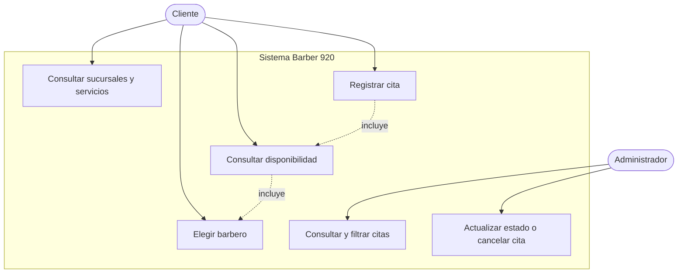

# Diagrama de casos de uso

Lo armamos el 1 de septiembre y le agregamos la elección de barbero el 8 de noviembre.

## Descripción

| Caso | Actor | Qué obtiene |
|---|---|---|
| UC-01 Consultar sucursales y servicios | Cliente | Ve dónde están las sucursales y qué servicios hay. |
| UC-02 Consultar disponibilidad | Cliente | Ve los horarios libres del barbero que eligió. |
| UC-03 Registrar cita | Cliente | Deja sus datos y recibe una confirmación. |
| UC-04 Consultar y filtrar citas | Administrador | Ve las citas por fecha, sucursal o barbero. |
| UC-05 Actualizar o cancelar cita | Administrador | Cambia el estado de una cita. |
| UC-06 Elegir barbero | Cliente | Escoge a un barbero o deja "Sin preferencia". |

Cuando el dueño confirme las reglas, agregaremos los avisos y los cambios de cita.
