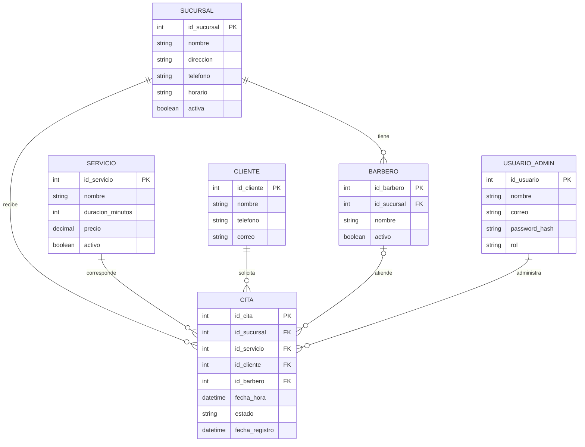

# Modelo entidad-relación preliminar

Es el modelo que propusimos el 1 de septiembre. Hoy la base de datos guarda las citas (con su barbero desde el 8 de noviembre), la cuenta del administrador y las sesiones. Los barberos, los clientes y los servicios tendrán su propia tabla cuando el dueño nos pase los datos reales.

## Reglas del modelo

- **Cita:** pertenece a una sucursal, un servicio y un cliente.
- **Barbero:** cada cita nueva tiene uno. Las citas guardadas antes del 8 de noviembre no tienen.
- **Sin choques:** un barbero no puede tener dos citas al mismo tiempo.
- **Estados:** Pendiente, Confirmada, Realizada y Cancelada.
- **Contraseñas:** nunca se guardan como texto.
