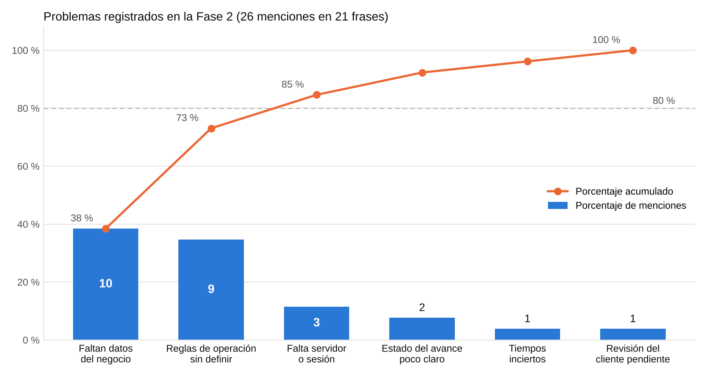

# Riesgos de la Fase 3

**8 de noviembre de 2026.**

Primero revisamos qué problemas se repitieron en la Fase 2 con un diagrama de Pareto. Con eso armamos la tabla de riesgos de esta fase y cómo los vamos a bajar.

## Diagrama de Pareto

Contamos los problemas que escribimos en las minutas 5 a 18 y en los reportes semanales 3 a 9. Son 21 frases. Si una frase habla de dos causas, cuenta en las dos, así que salen 26 menciones.

| Causa | Menciones | Porcentaje | Acumulado |
|---|---:|---:|---:|
| Faltan datos del negocio | 10 | 38.5 % | 38.5 % |
| Reglas de operación sin definir | 9 | 34.6 % | 73.1 % |
| Falta servidor o sesión | 3 | 11.5 % | 84.6 % |
| Estado del avance poco claro | 2 | 7.7 % | 92.3 % |
| Tiempos inciertos | 1 | 3.8 % | 96.2 % |
| Revisión del cliente pendiente | 1 | 3.8 % | 100 % |

Dos causas suman el 73 % de los problemas: los datos que faltan del negocio y las reglas que no están definidas. Las dos dependen del dueño. La tercera, falta servidor o sesión, ya la resolvimos el 29 de septiembre. Por eso el riesgo más grande de esta fase está en la reunión con el dueño y no en el código.

### De dónde sale cada conteo

| Fuente | Problema escrito | Causa |
|---|---|---|
| Minuta 5 | Mantener el mismo estado en el documento y en GitHub | Estado del avance |
| Minuta 6 | Falta la información operativa del cliente | Datos |
| Minuta 7 | Las reglas dependen de la entrevista | Reglas |
| Minuta 8 | Faltan datos reales, servidor y autenticación | Datos, servidor |
| Minuta 9 | El boceto puede confundirse con el sistema terminado | Estado del avance |
| Minuta 10 | No hay respuestas del dueño sobre las reglas | Reglas |
| Minuta 11 | No hay base compartida ni sesión real | Servidor |
| Minuta 12 | No se puede configurar la disponibilidad por barbero | Reglas |
| Minuta 13 | Las pruebas no confirman las reglas reales | Reglas |
| Minuta 14 | Se usan datos y reglas de prueba | Datos, reglas |
| Minuta 15 | Los tiempos pueden cambiar después de la entrevista | Tiempos |
| Minuta 16 | Algunos datos se completarán después | Datos |
| Minuta 17 | Faltan barberos y catálogo, capacidad y plazo de cancelación | Datos, reglas |
| Minuta 18 | Falta SUC 3 y la configuración por barbero | Datos, reglas |
| Reporte 3 | Faltan datos operativos | Datos |
| Reporte 4 | Faltan servicios, horarios y personal | Datos |
| Reporte 5 | El boceto usa datos de prueba | Datos |
| Reporte 6 | Faltan reglas de personal, capacidad y cancelación | Reglas |
| Reporte 7 | Las citas no se comparten entre navegadores | Servidor |
| Reporte 8 | La agenda por barbero depende de datos que no tenemos | Reglas |
| Reporte 9 | Faltan datos y la revisión del avance | Datos, revisión |

## Tabla de riesgos

Usamos tres niveles para la probabilidad y el impacto: bajo (1), medio (2) y alto (3). La prioridad es la multiplicación de los dos.

| # | Riesgo | Probabilidad | Impacto | Prioridad | Cómo lo bajamos | Responsable |
|---|---|---|---|---:|---|---|
| 1 | El dueño no nos da los barberos, sus descansos y el catálogo | Alta | Alto | 9 | Pedírselos en la reunión con una lista corta. Mientras, la página usa barberos de prueba y lo dice en el aviso. Cambiarlos solo toca dos listas del servidor | Alison y Dante |
| 2 | No logramos la reunión de revisión con el dueño | Media | Alto | 6 | Proponerle dos fechas y una reunión corta de 30 minutos. Puede ser en la barbería o por videollamada, con la página en el celular | Carlos y Luis |
| 3 | El calendario se vuelve a atrasar | Alta | Medio | 6 | Seguir el orden de seis jornadas de la planificación y revisar el avance cada semana en el Issue #18 | Luis |
| 4 | Publicar la página cuesta dinero que no está definido | Alta | Medio | 6 | La entrega funciona en local. Si el dueño quiere publicarla, primero cotizamos dominio y alojamiento y él decide | Luis |
| 5 | Las reglas reales son distintas a lo que supusimos, como más barberos o un plazo para cancelar | Media | Medio | 4 | Las reglas están en una sola función del servidor y las pruebas automáticas se pueden repetir después de cada cambio | Jesús |
| 6 | Alguien guarda datos personales reales en el prototipo | Baja | Alto | 3 | La página avisa que es de prueba y pide marcar una casilla. La base de datos no se sube a GitHub y la contraseña del panel va en una variable de entorno | Carlos |
| 7 | Se pierden o se empalman citas viejas al actualizar la base | Baja | Alto | 3 | El servidor agrega la columna de barbero sin borrar nada y una prueba lo revisa. Antes de actualizar, sacar copia de `data/barber.sqlite` | Jesús |
| 8 | El documento y GitHub dicen cosas distintas | Media | Bajo | 2 | El README y el Issue #18 son la referencia. Se actualizan el mismo día que el documento | Luis |
| 9 | Alguien no puede correr el proyecto por su versión de Node.js | Media | Bajo | 2 | El README pide Node.js 24. Las pruebas explican cómo correrlo con Node.js 22 | Jesús |

Los riesgos 1 y 2 vienen de las dos causas más grandes del Pareto. Si sale bien la reunión con el dueño, bajan los dos.
